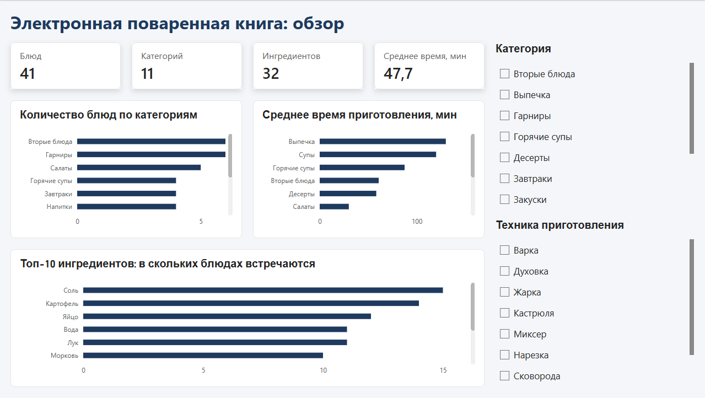
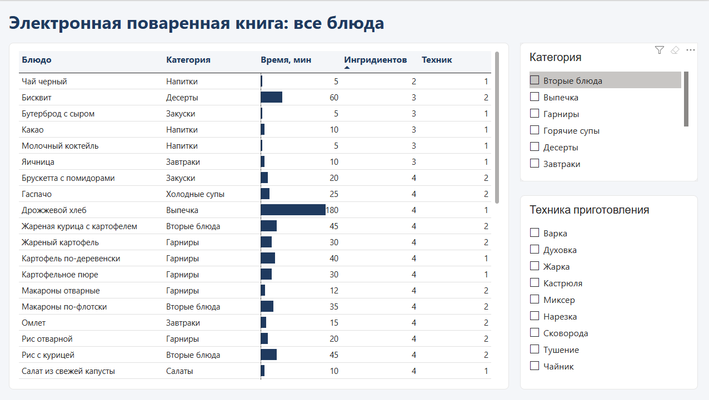

# Электронная поваренная книга — база данных на PostgreSQL

Учебный проект по курсу «Базы данных» (НИЯУ МИФИ, 2025–2026 учебный год). Я проектировал реляционную БД для предметной области «электронная поваренная книга» и на её таблицах выполнял лабораторные работы по SQL.

## Предметная область

Категории блюд в виде дерева (с вертикальным и горизонтальным порядком), блюда, ингредиенты, таблица соответствия нестандартных единиц измерения стандартным (стакан → граммы и т. п.), техники приготовления, фото и альтернативные названия ингредиентов. Блюдо принадлежит одной категории, количество ингредиентов можно указывать в любых единицах.

## Что в проекте

- Схема из 11 таблиц, приведена к 3НФ/НФБК, ER-диаграммы построены в pgAdmin4 (IDEF1X и Crow's foot).
- Целостность данных: PRIMARY / FOREIGN KEY, UNIQUE, NOT NULL, CHECK; словари для повторяющихся значений (единицы измерения, техники); самоссылающаяся таблица для дерева категорий.
- Аналитические запросы: JOIN, GROUP BY / HAVING, подзапросы, CTE, оконные функции, `STRING_AGG`.
- Транзакции, триггеры и функции на PL/pgSQL, пользовательская агрегатная функция, представление с `INSTEAD OF`.

## Структура

**`setup/`: создание базы (выполнить по порядку)**

| Файл | Что делает |
|---|---|
| `01_schema.sql` | создаёт 11 таблиц |
| `02_data.sql` | начальные тестовые данные |
| `03_dashboard_data.sql` | дополнительные данные (41 блюдо, 11 категорий, 32 ингредиента) и представление `v_dishes_overview` для BI-инструментов |

**`queries/`: примеры запросов (после `setup/`)**

| Файл | Что внутри |
|---|---|
| `analytics.sql` | JOIN, GROUP BY / HAVING, подзапросы, CTE, оконные функции, `STRING_AGG` |
| `transactions.sql` | транзакции с `ROLLBACK`, `UPDATE`, `ALTER TABLE` с `CHECK` |
| `triggers_and_functions.sql` | триггеры (лимиты на число блюд и ингредиентов), функции PL/pgSQL, агрегатная функция, представление с `INSTEAD OF` |

## Дашборд (Power BI)

Дашборд из двух страниц на данных этой БД (представление `v_dishes_overview`): блюда по категориям, среднее время приготовления, топ-10 ингредиентов, таблица блюд, фильтры по категории и технике приготовления.

Файл: [`dashboard/cookbook_dashboard.pbix`](dashboard/cookbook_dashboard.pbix)ы